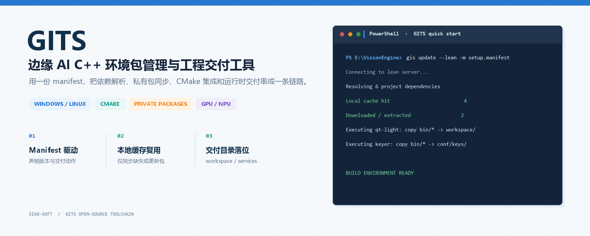
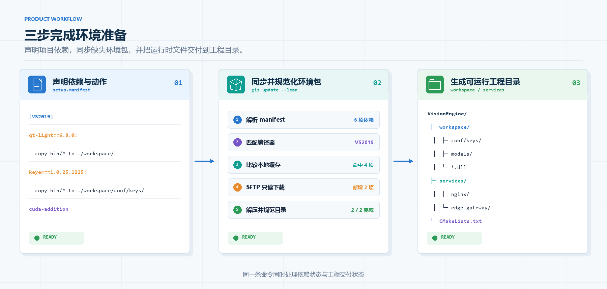
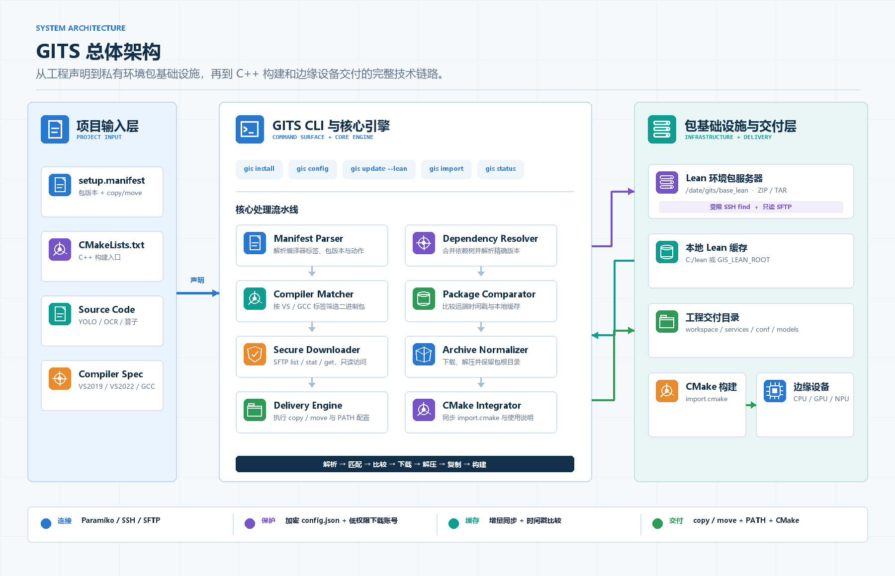
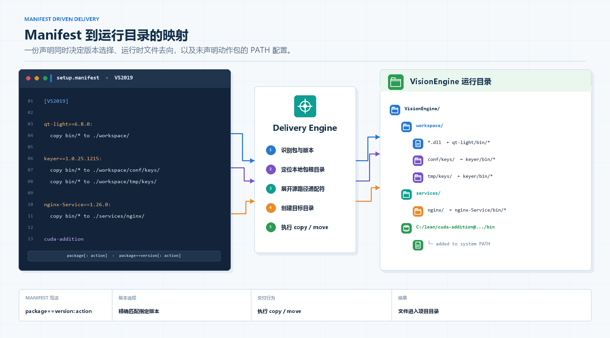
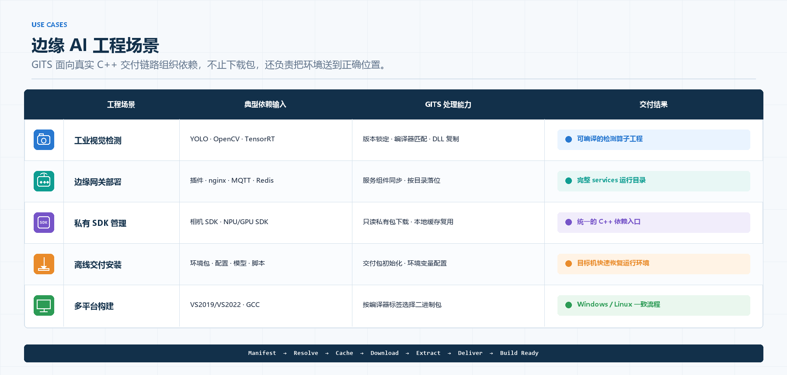

# GITS

> 面向边缘 AI 推理算子的 C\+\+ 环境包管理与工程交付工具。

GITS 聚焦工业视觉、YOLO 推理、NPU/GPU 算子和私有 C\+\+ SDK 交付场景，通过 `manifest` 描述依赖，一条命令完成环境包同步、CMake 配置、运行时文件复制和项目初始化。



[](https://codespaces.new/jgz-123/Gits-test)

[文档总目录](docs/README.md) · [Windows 快速入门](docs/01-快速入门.md) · [命令与配置参考](docs/03-命令与配置参考.md) · [案例库](docs/案例库/README.md)

## 🧪 浏览器在线体验

点击上方按钮，登录 GitHub 并创建 Codespace。初始化完成后打开终端，体验“缺依赖构建失败 → gits 补齐依赖 → 构建运行成功”。编译器、CMake 和 gis 会自动准备好。

先尝试构建：

```bash
cmake -S . -B build
cmake --build build
```

首次构建会因缺少 `demo_math.hpp` 而失败，这是预期的缺依赖状态。补齐依赖并重试：

```bash
gis update --lean -m setup.manifest --no-obj
cmake --build build
./build/delivery_smoke
```

预期输出 `2 + 3 = 5`。[查看完整体验步骤及验证方法](playground/README.md)。

在线体验使用独立的 Linux C++ 头文件示例，无需团队服务器账号。Windows 发行版的 exe 安装、私有 SDK 和真实推理流程请按使用文档操作。

## 🧭 产品工作流



## 🏗️ 整体架构



## ✨ 核心特性

### 🔌 边缘 AI 环境包接入

内置面向边缘 AI 工程的环境包管理能力，覆盖 C\+\+ 运行时、推理组件、服务组件、配置资源和工程交付目录：

|分类|GITS 支持内容|
|---|---|
|C\+\+ 运行时|DLL、lib、include、CMake import、运行时资源|
|推理组件|YOLO、OpenCV、TensorRT、NPU/GPU SDK、算法算子包|
|服务组件|nginx、Redis、MQTT、edge\-gateway\-plugin、后端服务模块|
|工程交付|workspace、services、conf、tmp、models 等目录自动复制|
|多平台编译器|Windows VS2019/VS2022、Linux GCC、按编译器标签匹配环境包|

提供统一的 `manifest` 写法，将“需要什么包”和“复制到哪里”写在同一个文件中，减少手动拷贝 DLL、配置路径和维护 CMake 的成本。

### 🗺️ Manifest 到运行目录映射

下图展示版本声明、`copy/move` 动作与最终工程目录之间的对应关系。带动作的环境包按规则进入项目目录；没有动作、但包含 `bin` 目录的环境包则由 GITS 检查并配置到系统 `PATH`。



### 🧠 面向边缘 AI 算子的工程自动化

GITS 将边缘 AI 算子工程里常见的环境准备动作收敛到一套命令流程：

- **依赖声明**：通过 `setup.manifest`、`lean.manifest` 声明项目所需环境包

- **版本匹配**：支持 `package==version` 精确版本，也支持自动选择最新可用版本

- **编译器匹配**：根据 VS/GCC 标签选择对应二进制包，降低 ABI 不匹配风险

- **自动同步**：自动下载本地缺失或服务器更新的环境包

- **运行时复制**：按 `copy ... to ...` 规则复制 DLL、模型、配置和服务文件

- **CMake 集成**：同步 `import.cmake`，让 C\+\+ 工程可以统一引入环境包

### 📦 私有环境包分发

GITS 适合企业内部维护私有二进制环境包，尤其适用于不能完全依赖公网包管理器的工业项目：

- 支持通过 SFTP/SSH 从私有服务器读取环境包

- 支持本地 lean 环境包缓存，避免重复下载

- 支持加密 `config.json`，降低服务器连接信息明文暴露风险

- 支持低权限下载账号，只读访问环境包目录和安装包目录

### 🧩 Manifest 驱动交付

项目只需要维护一个 manifest 文件，即可描述依赖包和复制动作：

```text
[VS2019]

VisionEngine-remote==1.0.26.0513: copy bin/* to ./workspace/
mosquitto-Service==2.0.22: copy bin/* to ./services/mosquitto/
Redis_x64-Service==5.0.14.1: copy bin/* to ./services/Redis_x64/
CInference-yolov11-libtorch==1.0.26.0118: copy bin/* to ./workspace/
Frontend-caixuntui-remote==2.0.26.0411: copy bin/* to ./services/nginx/html/
```

常用动作格式：

```text
copy <包内路径> to <项目内目标路径>
```

例如：

```text
copy bin/* to ./workspace/
copy models/* to ./workspace/models/
copy conf/* to ./workspace/conf/
copy bin/* to ./services/nginx/
```

## ⚡ 快速开始

Windows 用户先取得发行包，按 [5 分钟快速入门](docs/01-快速入门.md) 在发行包目录的管理员终端中安装：

```cmd
gis.exe install
```

查看或修改本地 lean 环境包目录：

```bash
gis config --lean_local_path
gis config --set_lean_local_path D:\lean
```

在项目根目录执行环境包同步：

```bash
gis update --lean -m setup.manifest --no-obj
```

典型输出：

```text
Connecting to lean server...
Checking local lean packages:
Fetching missing lean packages:
Lean fetch process finish~
Starting copy lean dll to workspace...
Your local lean packages are all up to date with remote lean server.
```

> 安装脚本中推荐使用 `--no-obj`，让命令专注完成环境包同步和文件复制。

## 🛠️ 技术栈

GITS 使用轻量化 Python CLI 实现，围绕 C\+\+ 工程交付场景集成常用构建与远程同步能力：

|类型|技术|
|---|---|
|CLI 工具|Python、argparse、PyInstaller|
|远程同步|Paramiko、SSH、SFTP|
|构建系统|CMake、import\.cmake|
|依赖声明|`.manifest`、`.dep`|
|环境包格式|zip、tar、tar\.gz、rar、7z|
|平台支持|Windows、Linux|
|编译器标签|VS2019、VS2022、GCC|
|配置保护|加密 `config.json`、敏感参数密码校验|

## 📚 文档与社区

|资源|说明|
|---|---|
|代码仓库|[jgz-123/Gits-test](https://github.com/jgz-123/Gits-test)|
|快速开始|[从安装到环境包同步](docs/01-快速入门.md)|
|Manifest 规范|[包声明、版本与复制规则](docs/03-命令与配置参考.md)|
|配置说明|[服务器、本地缓存与敏感参数](docs/03-命令与配置参考.md)|
|命令参考|[命令与配置参考](docs/03-命令与配置参考.md)|
|环境包规范|[发布、目录结构和编译器匹配](docs/02-进阶教程.md)|
|案例库|[业务场景与示例清单](docs/案例库/README.md)|

## 🌍 应用场景



|场景|说明|
|---|---|
|工业视觉检测|快速同步 YOLO/OpenCV/TensorRT 等推理依赖，构建产线检测应用|
|边缘网关部署|将算法插件、服务组件、配置文件复制到 workspace 和 services 目录|
|私有 SDK 管理|管理相机 SDK、NPU/GPU SDK、内部算法库等二进制依赖|
|离线交付安装|交付包中内置 GITS，通过 manifest 一键恢复运行环境|
|多项目环境复用|多个工程共享本地 lean 环境包缓存，减少重复下载和配置|

## 🤝 参与贡献

欢迎围绕边缘 AI 工程交付场景补充能力。GITS 更关注“让项目稳定交付”，因此贡献内容不只包括代码，也包括环境包规范、manifest 示例、工程模板和真实项目经验。

### 可以贡献什么

|类型|内容|
|---|---|
|CLI 能力|`gis install`、`gis config`、`gis update`、`gis status` 等命令改进|
|Manifest 示例|YOLO、OCR、分割、检测、边缘服务等项目的依赖声明模板|
|环境包规范|包目录结构、版本命名、编译器标签、stable/common 发布规则|
|工程模板|CMake 工程模板、算子模板、服务目录模板、交付包模板|
|文档案例|快速开始、常见问题、迁移指南、VisionEngine 等真实项目案例|
|平台适配|Windows、Linux、VS2019/VS2022、GCC、NPU/GPU SDK 兼容性验证|

### 贡献流程

1. Fork [jgz-123/Gits-test](https://github.com/jgz-123/Gits-test) 或拉取目标分支。

2. 基于当前开发分支创建新的功能分支。

3. 完成代码、文档、manifest 或模板修改。

4. 在本地验证相关命令是否可以正常执行。

5. 提交 Pull Request，并说明修改目的、验证方式和影响范围。

建议分支命名：

```text
feature/<your_name>/<feature_description>
fix/<your_name>/<bug_description>
docs/<your_name>/<document_description>
```

建议提交信息保持清晰：

```text
feat: add yolo operator manifest template
fix: handle missing bin directory in lean package
docs: add gis update lean quickstart
```

### 提交前检查

代码或脚本修改建议至少验证相关命令：

```bash
python -m py_compile gits/lean.py gits/commands.py utils/write_to_path.py
gis version
gis update --lean -m setup.manifest --no-obj
```

文档或 manifest 修改建议检查：

- manifest 中包名、版本号和服务器环境包一致

- `copy ... to ...` 目标路径符合项目交付目录

- 示例命令可以在项目根目录直接执行

- 不提交真实服务器密码、私有 SDK、客户配置或本地绝对路径

### Pull Request 说明建议

```text
## 修改内容
-

## 验证方式
-

## 影响范围
-

## 备注
-
```

## 📄 开源协议

当前协议状态：待确认。

在正式开源协议确定前，建议按内部项目或受限开源项目管理：

- 个人学习、研究和内部验证可按项目规则使用

- 企业商用、二次分发、环境包镜像和私有部署需先确认授权边界

- 服务器账号、环境包、私有 SDK 和业务配置不应提交到公开仓库
